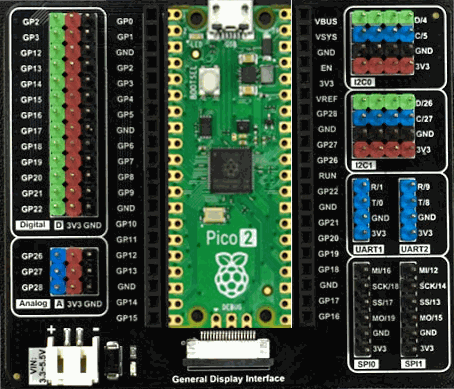

# Harp Hobgoblin

The Harp Hobgoblin is a simple multi-purpose device for learning the basics of the Harp standard, meant to be adapted and modified for a variety of purposes. It runs directly on a Raspberry Pi Pico or Raspberry Pi Pico 2, reads digital and analog inputs, controls digital outputs and pulse trains, and timestamps every input and output on the same hardware clock.

## Documentation

The [device documentation](https://harp-tech.org/device.hobgoblin) covers the specifications, assembling the device, installing the software and firmware, tutorials on acquisition, control and a reaction time task, and the register reference.

## Software

The device can be used from [Bonsai](https://bonsai-rx.org/) through the `Harp.Hobgoblin` package, or from Python through the `harp-hobgoblin` package. The [installation](https://harp-tech.org/device.hobgoblin/articles/installation.html) page describes how to install each of them.

## Repository layout

- `device.yml` describes the registers of the device. The .NET and Python interfaces are generated from it.
- `firmware` holds the firmware of the device, built with the Raspberry Pi Pico SDK.
- `software` holds the .NET package, which includes the Bonsai operators, and the Python package.
- `docs` holds the documentation site.

## Licensing

Each part of this repository is released under its own license. The `LICENSE` file at the root of the repository lists the licenses that apply to each folder.
