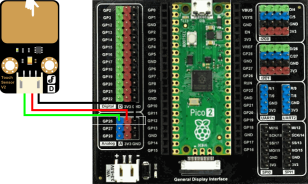

# Bonsai

[Bonsai](https://bonsai-rx.org/) is a visual reactive programming language for building interactive experiments and processing data streams in real time. This article covers a first workflow to test the Hobgoblin in Bonsai.

Before beginning:

{width=400}

- Install Bonsai and the `Harp.Hobgoblin` package, as described in [Installation](installation.md#software-packages).
- Connect a touch sensor to analog input channel 0, on pin GP26.
- Connect the Hobgoblin to the computer with a USB cable.
- Hover over the workflow cell below, click the "Copy" icon on the top right, and paste the workflow into Bonsai.

:::workflow

:::

- Set the `PortName` property of the [`Device`] operator to the communications port of the Hobgoblin, for example `COM7`.
- Run the workflow and double-click the output of `AnalogInput0`. The value changes when the touch sensor is pressed.

The [tutorials](acquisition-and-control.md) build on this workflow to acquire and record data, and to control the digital outputs.

[`Device`]: xref:Harp.Hobgoblin.Device
