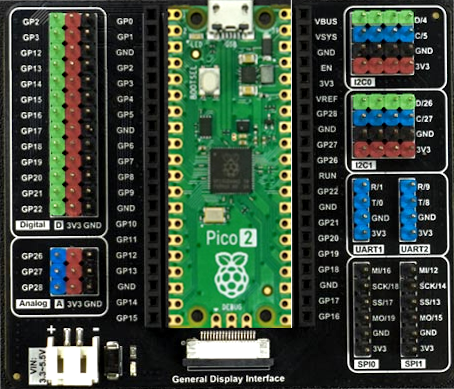

# Hobgoblin device

{width=300}

## Pin assignments

The pins are numbered as on the Raspberry Pi Pico, as printed on the Gravity: Expansion Board.

| Function | Pins |
| -------- | ---- |
| Digital inputs | GP2, GP3, GP12, GP13, GP14 |
| Digital outputs | GP15 to GP22 |
| Analog inputs | GP26, GP27, GP28, as channels 0, 1 and 2 |
| Harp synchronization clock input | GP5 |

## Firmware

| Version | Notes |
| ------- | ----- |
| 0.2 | <ul><li> One firmware image for both the Raspberry Pi Pico and the Pico 2 </li><li> Firmware updates with `harp.toolkit` on the Pico 2 </li><li> Reports the firmware, hardware and protocol versions and the interface hash in `R_VERSION` </li></ul> |
| 0.1 | <ul><li> Initial version </li></ul> |
