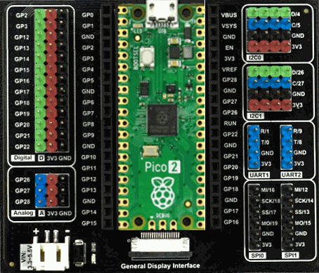

# Hobgoblin device

{width=300}

## Pin assignments

The pins are numbered as on the Raspberry Pi Pico, as printed on the Gravity: Expansion Board.

| Function | Pins |
| -------- | ---- |
| Digital inputs | GP2, GP3, GP12, GP13, GP14 |
| Digital outputs | GP15 to GP22, with hardware pulse trains on GP18, GP20 and GP22 |
| Analog inputs | GP26, GP27, GP28, as channels 0, 1 and 2, reported at 250 Hz |
| Harp synchronization clock input | GP5 |

The analog inputs are sampled continuously, and each `AnalogData` event carries the latest value of each channel.

## Pulse trains

The registers `PulseTrainGP15` to `PulseTrainGP22` run an independent pulse train on each digital output. Each register takes the pulse width and period in microseconds, and the number of pulses. A count of zero repeats the pulses until they are stopped, and a width of zero stops the pulse train and keeps its period and count. A write to `DigitalOutputSet`, `DigitalOutputClear`, `DigitalOutputToggle` or `DigitalOutputState` also stops the pulse train on each line it changes.

The start of each pulse is reported as an event on `DigitalOutputSet`, and `PulseEventEnable` turns these events off for selected lines. The end of each pulse is not reported, since it follows from the start of the pulse and its width. When a pulse train finishes or is stopped by a write to its line, its register reports a width of zero.

Pulse trains on GP18, GP20 and GP22 run on the PWM hardware of the Pico. Without events or a pulse count, their pulses can be much faster. Pulses on the other outputs, and pulses longer than about 110 ms apart on these pins, run on software timers.

| Limit | Value |
| ----- | ----- |
| Shortest pulse period on the other outputs, or with events or a pulse count | 500 µs |
| Shortest pulse period on GP18, GP20 or GP22, without events or a pulse count | 10 µs |
| Pulse events across all lines | 4000 per second |

A write that would exceed a limit is rejected with a write error, and the register keeps its previous value.

## Firmware

| Version | Notes |
| ------- | ----- |
| 0.2 | <ul><li> One firmware image for both the Raspberry Pi Pico and the Pico 2 </li><li> Firmware updates with `harp.toolkit` on the Pico 2 </li><li> Reports the firmware, hardware and protocol versions and the interface hash in `R_VERSION` </li><li> One pulse train register for each output, replacing `StartPulseTrain` and `StopPulseTrain` </li><li> Hardware pulse trains on GP18, GP20 and GP22 </li><li> `DigitalInputState` and `DigitalOutputState` read the current state of the pins </li></ul> |
| 0.1 | <ul><li> Initial version </li></ul> |
